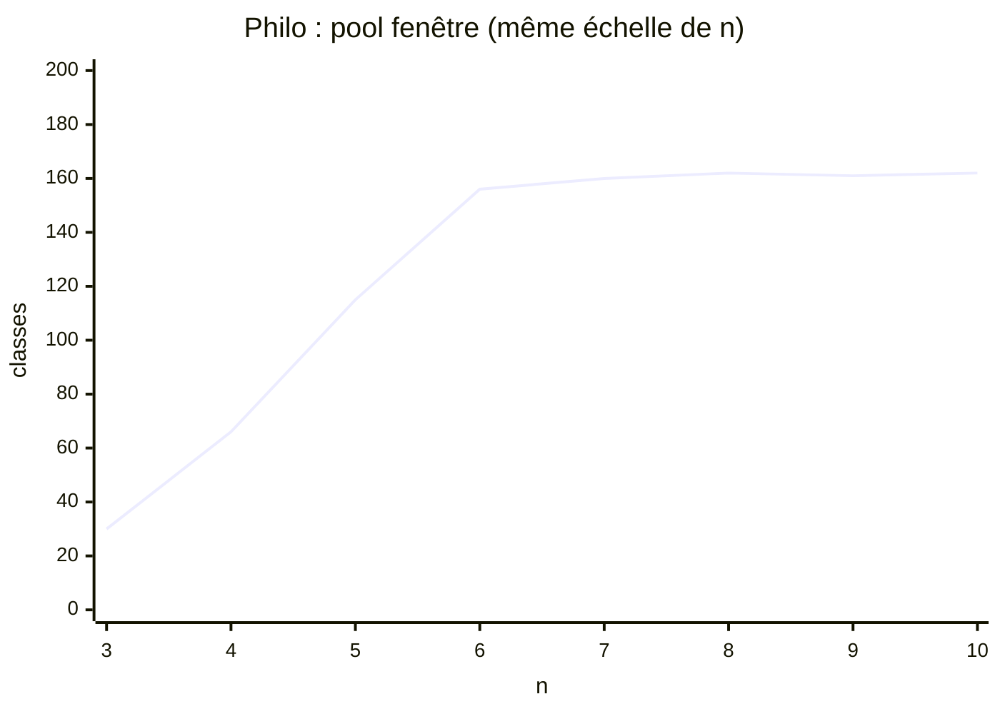

# Étude « surcharge d'homogénéité » sur petites instances

Petite étude expérimentale répondant aux trois questions laissées ouvertes par la discussion : (1) le moteur plat croît-il bien en Θ(n) sur les familles visées ; (2) le quotient à fenêtre borne-t-il le pool en O(1) ; (3) le classifieur de niveau contrôleur produit-il le bon plan de coutures avant toute construction. En garniture : S→S' contre annotation, chiffré.

Toutes les familles sont des **proxys simplifiés**, pas le modèle exact de lisage ([Projets saucisson](knowledge://knowledge/saucisson-projects/KNOWLEDGE.md)) : alphabets locaux réduits, pas de transductions attribuées, pas de saturation. Le protocole : BFS explicite (vérité terrain), formules fermées en contre-vérification, trois moteurs.

## 1. Familles de modèles

| Famille | Proxy MCC | Un p'tit grain d'asymétrie |
|---|---|---|
| **Philo** (n = 3..10) | Philosopher : anneau à 4 états locaux (T, L, E, R), saisie gauche puis droite | aucun : homogène |
| **Pressé** (n = 3..10) | Anderson/FMS-ish : le philosophe 0 saisit ses deux fourchettes **atomiquement** (2 états locaux) | couture par classe de module, position fixe |
| **Jeton** (n = 3..16) | TokenRing : anneau {N, W, T, C}, un jeton unique, section critique puis passage à gauche | couture par marquage initial (porteur unique) |

## 2. Trois moteurs

- **plat** : MDD exact positionnel (table unique incluant la position exacte), sur l'anneau brut. C'est le « moteur plat-hiérarchique » du débat.
- **ancré** : même MDD exact, mais sur l'ensemble des configurations **ancrées par rotation**. Témoin : l'ancrage seul, sans fenêtre.
- **fenêtre** : quotient cyclique à fenêtre ; classe de nœud = (cap gauche, cap droite, lettre d'ancrage, triplet local). Proxy du pool lisage (fenêtre glissante + handles).

## 3. Résultats : Philo (homogène)

| n | \|S\| atteints | cohérents | plat | ancré | pool fenêtre | formes |
|---|---|---|---|---|---|---|
| 3 | 26 | 27 | 9 | 9 | 30 | 4 |
| 4 | 80 | 81 | 14 | 15 | 66 | 4 |
| 5 | 242 | 243 | 19 | 24 | 115 | 4 |
| 6 | 728 | 729 | 24 | 44 | 156 | 4 |
| 8 | 6 560 | 6 561 | 34 | 121 | 162 | 4 |
| 10 | 59 048 | 59 049 | 44 | 330 | 162 | 4 |

- **Formules fermées vérifiées** : atteints = 3ⁿ − 1, cohérents = 3ⁿ, plat = **5n − 6** exactement.
- **Le seul état cohérent jamais atteint** : (R, R, …, R), « tous en train de relâcher à droite ». Chacun devrait être passé par E (les deux fourchettes), ce qu'aucun historique joint ne permet. Le quotient se construit donc bien sur l'atteignable, pas sur le langage local.
- Pool fenêtre : **plateau 162** dès n = 8 (oscillation 161/162 = bruit de bord).

```mermaid
xychart-beta
  title "Philo : MDD plat (n = 3 à 10)"
  x-axis "n" [3, 4, 5, 6, 7, 8, 9, 10]
  y-axis "nœuds" 0 --> 50
  line [9, 14, 19, 24, 29, 34, 39, 44]
```



## 4. Résultats : Pressé (couture de classe)

| n | \|S\| | plat | pool S→S' | formes S' | pool annoté | formes annotées |
|---|---|---|---|---|---|---|
| 3 | 15 | 7 | 45 | 6 | 46 | 4 |
| 5 | 135 | 15 | 164 | 6 | 165 | 4 |
| 8 | 3 645 | 27 | 182 | 6 | 183 | 4 |
| 10 | 32 805 | 35 | 182 | 6 | 183 | 4 |

- Atteints = **5·3ⁿ⁻²** exactement ; plat = **4n − 5**.
- **S→S' contre annotation, chiffré** : pools quasi identiques (182 contre 182 + 1 nœud décoré de couture). Le gain est dans la **table des formes : 6 contre 4 + 1**, soit 3×6 = 18 entrées contre 3×4 + 1 = 13, **−28 %**. La surcharge achète des entrées de quotient, pas des nœuds de fenêtre : cohérent avec l'ordre de grandeur annoncé (~10 à 30 %), et pas plus.

## 5. Résultats : Jeton (couture de marquage)

| n | \|S\| = n·2ⁿ | plat = 2n−1 | ancré = n | pool fenêtre |
|---|---|---|---|---|
| 3 | 24 | 5 | 3 | 24 |
| 5 | 160 | 9 | 5 | 56 |
| 8 | 2 048 | 15 | 8 | 56 |
| 12 | 49 152 | 23 | 12 | 56 |
| 16 | 1 048 576 | 31 | 16 | 56 |

- Toutes les formules fermées vérifiées (atteints = cohérents = n·2ⁿ ; plat = 2n − 1 ; **ancré = n exactement**, une classe par position).
- Pool fenêtre : **56, plat dès n = 5, jamais démenti jusqu'à n = 16**.

## 6. Synthèse

| Grande | Philo | Pressé | Jeton |
|---|---|---|---|
| pente plat (nœuds/n) | **5,00** | **4,00** | **2,00** |
| pool fenêtre asymptotique | **162** | **182 (+1)** | **56** |
| croisement plat / pool | n ≈ 34 | n ≈ 46 | n ≈ 29 |

1. **Θ(n) plat confirmé** sur les trois familles, pentes exactes 5/4/2 par module ; à l'échelle des paramètres du MCC (centaines), c'est un facteur 30 à 40 de nœuds.
2. **La fenêtre est le mécanisme porteur**, pas l'ancrage : le MDD exact ancré reste linéaire sur le jeton (n exactement) et **dégrade** même Philo (9 → 330 à n = 10, artefact du choix d'ancre par plus haute lettre). Sans handles/fenêtre, aucun pli ne tient en O(1) ; avec, les plateaux sont nets.
3. **Détection contrôleur validée** : les trois plans ont été calculés **avant construction** (classes de modules + orbite du marquage initial) et étaient tous corrects : philo → plan vide (zéro-injection vérifiée : aucune surcharge nécessaire, pool constant sans décoration) ; pressé → couture au module 0 (singleton de classe) ; jeton → ancre dynamique au porteur unique.
4. **Sous le point de croisement (n ≲ 30), le plat exact reste plus petit que le pool fenêtre.** L'honnêteté l'exige : le gain lisage est asymptotique ; il paie à l'échelle MCC, pas sur des jouets à n ≤ 10.

## 7. Limites

- Modèles proxy : pas d'attributions, pas de saturation, pas d'événements à distance ; les constantes (162, 56) seraient différentes dans lisage, où le modèle philosophes à 7 formes est plus riche.
- Le « pool fenêtre » compte des classes de nœuds du quotient cyclique, pas les nœuds d'un moteur dépliable ; c'est une borne de structure, pas une mesure de `created`.
- L'« ancré » de Philo illustre qu'un mauvais choix d'ancre coûte ; ce n'est pas une mesure de lisage.

## 8. Suites naturelles

1. Injecter ces trois familles dans `lisage-bench` (jalon M7) et mesurer `created`, pic et pool réels contre les 5n − 6 / 4n − 5 / 2n − 1 obtenus ici : trois droites attendues.
2. Garder la **zéro-injection** (plan vide sur Philo homogène) comme test de non-régression du classifieur.
3. Le PNML du MCC donne les unités NUPN : le classifieur de modules peut être branché directement sur les fichiers du concours.