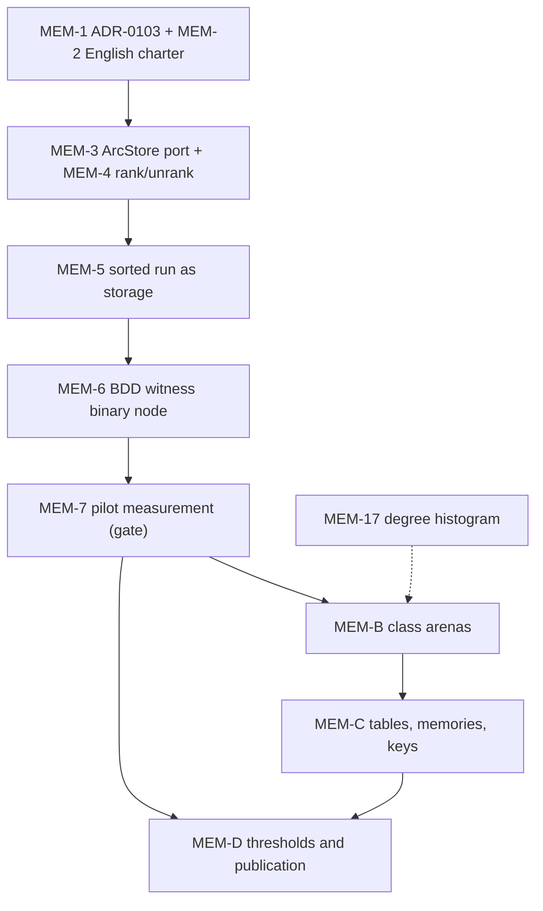

# Memory track: arc storage port and class-based arenas

*This document turns the accumulated analysis (canvas "specialized nodes per
controller", sections 1 to 8, whose conclusions it takes over without
re-arguing them) into an executable work specification: scope, invariants,
conventions, milestones, labels and issues. Base: repository `saucisson/lisage`,
branch `daily` (13 November 2026), roadmap
`docs/feuille-de-route-lisage-jalons-et-issues.md`, whose conventions this
document follows (labels, cycles, interface → tests → implementation
discipline).*

## 1. Purpose and scope

**Purpose.** Make the in-memory representation of nodes a function of the
parameters the controller already declares (cardinality of `Val(ℓ)`, default
`δ(ℓ)`, key group, observed fill), and bring the per-node cost from the order
of 420 bytes (`BTreeMap` form + cloned key from the unique table) down to the
order of 16 to 40 bytes, at constant `u32` identifier budget.

**In scope.**

1. An **arc storage port** (`ArcStore`) as an associated type of the
   controller, whose instance is chosen by the level parameters; reductions
   and transductions operate only on the port's iteration.
2. The **sorted run** as the storage for interned arcs (`Box<[(key, NodeId)]>`),
   the `BTreeMap` relegated to the role of build-time accumulator.
3. **Arenas by size class**: exact classes for degree d = 1..C plus a
   pointer catch-all class, `NodeId(u32)` = class bits + index bits, effective
   bit count b derived at runtime from the declared domains.
4. The **unique table without form cloning** (open addressing or chaining in
   the entry), **terminals in a dedicated class**, **co-located memories** in
   parallel arrays, **declared key width** per level.
5. The **instrumentation** that falsifies all of this: degree histogram,
   per-class metrics, counting allocator in CI, confrontation against
   witnesses.

**Out of scope (decisions already taken, not to be reopened).**

- No code generation from the controller before M5; opening criterion
  measurable on counters only (analysis § 5.7).
- No per-node conversion with copy at the ART: the boundary is the forest or
  the level, never the individual node.
- No 64-bit `NodeId`: doubling every arc is counter-productive; the bound is
  the `u32` format.
- No contract changes: C1, the verifiable `core`/`algebra` boundary and
  handle-based canonicity are intact; this track is "unobservable physical
  compression".

## 2. Technical specification

### 2.1 Arc storage port (`ArcStore`)

- Associated type of the controller in the `lisage-algebra` interface; the
  default instance is the current `BTreeMap`, so the first PR changes the
  interface without changing behavior.
- Minimal contract: ordered iteration of `(key, target)` (or `(rank, target)`
  when the rank exists), builder-side insertion, size. The pool never sees the
  concrete container.
- `rank`/`unrank` enter `KeyAlgebra`, derived from the region enumeration
  already required by the key contract; dense ordinal storage writes no code
  per controller.

### 2.2 Sorted run and normalization

- The `reduce` pipeline becomes: ephemeral accumulator (`BTreeMap` or
  `SmallVec`, transduction side); normalization into a sorted run with the
  "last write wins" semantics preserved (subtlety pinned by PBT); reductions
  over the run; hash-consing on the semantic form (level + sorted run), never
  on the tier.
- `Reduction::Forme` receives a "sorted arc run" type; transductions and
  reductions only see the iteration.
- The dense ordinal choice (rank available and fill at least one third, trivial
  threshold 4·|Val(ℓ)| ≤ 12·arcs) composes in the same normalization with the
  tier by arc count.

### 2.3 Identifiers and classes

- `NodeId(u32)` = class bits + index bits. The effective bit count b is
  **runtime**, derived from the domains: b = smallest integer such that
  2^b − 2 ≥ max_ℓ C(ℓ) (two reserved classes: terminals, catch-all). The
  maximum window b_max (typically 8) is compile-time; a degree beyond the
  effective window falls into the catch-all class without loss of correctness.
- Exact classes for degrees d = 1..C (exact-stride entries, macro-generated,
  monomorphized), one pointer catch-all class beyond. C(ℓ) = min(|Val(ℓ)|,
  N_max) by default; the unbounded level (DDD) takes a low default, with
  declarative override possible by the controller.
- Arenas created lazily, grown by doubling, slabs chunked at about 64 KiB
  (bounds the growth spike, allows page release when a class empties).
- Terminals: dedicated class (stride = payload size), which prepares the
  ADD/MTBDD instance of M5-4.

### 2.4 Tables, memories, keys

- Unique table: removal of the form clone from the key; target (open addressing
  of `(hash, NodeId)`, about 8 bytes per node at load factor 0.5) or chaining
  in the entry à la CUDD; removal of `ControllerId` from the key (redundant in
  a mono-controller `Arena<C>`) at minimum.
- Memories: `HashMap<(NodeId, Level), V>` (about 48 bytes per entry) replaced
  by dense parallel arrays per class, 4 to 8 bytes per entry; bounded eviction
  policy unchanged.
- Declared key width per level (u8/u16/u32): runs at 8 bytes per arc instead
  of 12.
- GC: mark bitmap at 1 bit per node, shadow index per level; tombstone +
  per-class remap protocol, an index is never reused outside the protocol.

### 2.5 Instrumentation

- Degree histogram per level in the Observer / `MetriquesPool`: it sets the C
  boundary and monitors drift; traces peak and live per class (slack
  measurement).
- Counting allocator in CI: end-to-end bytes per node (arena + tables) and
  allocations per interning as **non-regression thresholds**.
- Confrontation JSON line: VmHWM, time, node counts, table shares in RSS,
  per-class metrics; reproducibly randomized IDs (so that "layout on/off" does
  not capture the effect on hash functions).

## 3. Invariants (to be pinned in ADR-0103)

1. **Hash-consing key = semantic form** (level + arcs by rank and target),
   never the tier nor the layout: two layouts never create two nodes for the
   same form; C1 unchanged.
2. **Class map and b frozen for the life of the pool**: the class is a pure,
   stable function of (controller, level, degree); any adaptation goes through
   an explicit conversion (M3), never through silent mutation of the policy.
3. **A class's identifier space is never recycled**; an index is never reused
   outside the tombstone + remap protocol, for which memo holders remain
   responsible.
4. **Verifiable boundary preserved**: `core` inspects neither `Val(ℓ)` nor `δ`
   nor `⊕`; rank and cardinality live on the `algebra` side, the pool routes
   and memoizes.
5. **The schema remains runtime data**: the M3 oracle chooses representations
   and conversions at execution; no freezing of the schema into code before M5.
6. **Tripartite identifier budget** (class + index + transformer tag,
   contribution 8) arbitrated in ADR-0103 **before M4-2**.
7. **Execution order per unit of work**: interface, tests (red PBT,
   differential), implementation; do not generalize a tier until the pilot
   measurement has fixed the real factor.

## 4. Implementation conventions

### 4.1 The code is in English

**All new code is in English**: identifiers, types, functions, modules, test
names, doc comments, `DEBUG` event names (ADR-0005), error messages, commit
messages and PR titles. Rationale: the repository constitution (AGENTS.md,
ADRs, review checklist) is already in English, the Rust ecosystem requires it,
and differential review reads diffs, not prose.

- New modules of the track (`arc_store`, `sorted_run`, `arenas`, `class_map`...)
  are born in English.
- Existing French identifiers (`reduire`, `forme`, `cle`, `arène`...) are
  renamed **as they are touched**: each PR that touches a symbol renames it; no
  big-bang rename (budget ADR-0101: PRs under about 1,000 lines, one issue at
  a time).
- Documents in `docs/`, ADRs and discussions remain in French.
- The review checklist gains an item: "no new French identifier introduced".

### 4.2 Execution model

That of the roadmap, unchanged: one issue = one branch = one cycle (agent
session closed by a human review), PRs under about 1,000 lines, `/clear`
between PRs, just-in-time escalation of undecided points (the agent never
blocks, it escalates in the discussion). The track lives on `feat/mem-*`
branches from `daily`; it never touches `main` directly.

### 4.3 Scheduling guardrails

The track must not jeopardize the Rennes sprint (Petri Nets summary on 15
January 2027): M1/M2 conformance comes before compactness. Consequently MEM-3
to MEM-5 (the interface and the sorted run) land in M1 without behavior
change; the binary pilot (MEM-6) and the measurement (MEM-7) use the
confrontation runner that has just landed; everything else waits for the MEM-7
gate (constant factor measured, otherwise stop and escalate).

## 5. Milestones

| Milestone | Title | Roadmap anchor | Issues | Exit criterion |
| --------- | ----- | -------------- | ------ | -------------- |
| MEM-A | Port and pilot | M1 (2 to 3 cycles) | MEM-1 to MEM-7 | The `ArcStore` port compiles with the default `BTreeMap` (zero behavior change, green differential); the BDD witness binary node exists with a static `size_of`; the pilot confrontation line is published and the decision written: constant factor → continue, complexity gap → stop |
| MEM-B | Class arenas | M2 to M3 (2 to 3 cycles) | MEM-8 to MEM-13 | All families (binary, dense ordinal, sparse sorted) land in exact-stride arenas; inter-class C1 PBTs green; remap protocol extended; tag bits arbitrated (gate before M4-2) |
| MEM-C | Tables, memories, keys | M3 to M4 (1 to 2 cycles) | MEM-14 to MEM-16 | End-to-end bytes-per-node counter clearly down (target: factor of at least 5 on the BDD instance, arena + tables); zero arc allocation beyond the entry; memories in parallel arrays |
| MEM-D | Instrumentation and non-regression | transverse, closes at M4 | MEM-17 to MEM-19 | Active CI thresholds (counting allocator); histogram and per-class metrics in the JSON line; "layout on/off" measurement published with the real factor and the verdict |

The MEM-D counters open as early as MEM-A (the degree histogram is the
instrument that sets the C boundary of MEM-B); only their freezing into
non-regression thresholds waits for the close of MEM-C.

Dependencies between milestones:

## 6. Labels

Roadmap conventions, plus three new labels. Every issue of the track carries
`piste/memoire` and cites its statements in the body; every PR closes with
`Closes #n`.

| Label | Status | Usage |
| ----- | ------ | ----- |
| `piste/memoire` | new | all issues of this track |
| `type/perf` | new | issues whose acceptance is a performance measurement (MEM-6, MEM-14, MEM-19) |
| `garde/c1` | new | issues touching interning or remap, whose review must verify invariant 1 or 3 (MEM-5, MEM-9, MEM-10, MEM-14) |
| `area/core`, `area/algebra`, `area/bench` | existing | layers touched |
| `type/feat`, `type/test`, `type/doc`, `type/spike` | existing | nature of the issue |
| `jalon/M1` ... `jalon/M5` | existing | roadmap anchor (in addition to the GitHub MEM-x milestone) |
| `C1`, `C6`, `C8` | existing | falsifiable statements targeted |

## 7. Issues

### MEM-A: port and pilot (jalon/M1)

| Issue | Title | Content | Acceptance criteria | Labels |
| ----- | ----- | ------- | ------------------- | ------ |
| MEM-1 | ADR-0103: arc storage port and layouts per controller instance | Write the ADR with the seven invariants of § 3, the tripartite identifier budget and the reference to the analysis (canvas sections 4 and 5) | ADR merged in `docs/decisions/`; every PR of the track cites it; open questions listed there as gates (MEM-7, MEM-13) | type/doc, area/core, piste/memoire |
| MEM-2 | Charter: code in English | Amend AGENTS.md and the review checklist: § 4.1 of this document (new modules in English, on-the-fly renaming, docs and ADRs in French, review item "no new French identifier") | Item in the checklist; PRs MEM-3 and later comply with the charter; no big-bang rename (ADR-0101 budget checked by review) | type/doc, area/docs, piste/memoire |
| MEM-3 | `ArcStore` port in the interface | Associated type of the controller; ordered iteration `(key, target)`, insertion, size; default instance = current `BTreeMap`; reductions and transductions go through the port's iteration only | Compiles without behavior change; A/B/C differential green; `core` inspects neither `Val(ℓ)` nor `δ`; clean `cargo doc` | type/feat, area/core, area/algebra, C1, piste/memoire |
| MEM-4 | `rank`/`unrank` in `KeyAlgebra` | Derived from the region enumeration of the key contract; rank availability exposed to normalization | Round-trip PBT `rank ∘ unrank` on the bounded domains of the reference instance; unbounded domain: absence of rank properly declared (DDD path unchanged) | type/feat, area/algebra, piste/memoire |
| MEM-5 | Sorted run as arc storage | `reduce` normalizes into a sorted run ("last write wins" semantics pinned by PBT); hash-consing on the semantic form; `BTreeMap` relegated to the builder | One single arc allocation per interning (counter); confluence PBTs (`reduce ∘ reduce = reduce`, quotients) green; differential green; unique-table key unchanged at this stage | type/feat, area/core, area/algebra, C1, garde/c1, piste/memoire |
| MEM-6 | Binary node of the BDD witness (C6) | `const` generics instance: `{level, low, high}` plus the complement bit à la CUDD; the binary family is the `Val(ℓ) = 2` case of the port | Static `size_of` of the binary node published; C6 verified (cross-count with the CUDD witness); differential green | type/feat, area/core, C6, type/perf, piste/memoire |
| MEM-7 | Pilot measurement and generalization gate | Runner `alea-lcg` / `philosophes` / `fenêtre`, JSON line (VmHWM, time, counts), publication in `bench-results/` and WORKLOG; written decision: gap = constant factor → layout, MEM-B opens; complexity gap → stop and escalate | Measurement published and falsifiable (reproducible randomized IDs); decision written in the closed issue body; WORKLOG updated | type/test, area/bench, piste/memoire |

### MEM-B: class arenas (jalon/M2, gate MEM-7)

| Issue | Title | Content | Acceptance criteria | Labels |
| ----- | ----- | ------- | ------------------- | ------ |
| MEM-8 | `NodeId` split and runtime b | b = smallest b such that 2^b − 2 ≥ max_ℓ C(ℓ), derived from `cardinality()`; compiled b_max window (default 8); decoder parameterized by effective b | Derivation tested: BDD → b = 2 (30 index bits), philosophers → b = 3 or 4, open domain → low default with declarative override; invalid identifiers rejected by assertion | type/feat, area/core, piste/memoire |
| MEM-9 | Exact classes and catch-all class | Classes d = 1..C at exact stride (macro-generated, monomorphized), pointer catch-all beyond; lazy creation, doubling, 64 KiB chunks; class map frozen at construction (assertion) | Inter-class C1 PBTs green (same form, same `NodeId`, whatever the tier); exact-stride entry verified by static test; peak and live per class traced; the C boundary is justified by the histogram (MEM-17) | type/feat, area/core, C1, garde/c1, piste/memoire |
| MEM-10 | GC and multi-arena remap | Bitmap marking (1 bit per node), shadow index per level; tombstone + per-class remap protocol, generalized `dernier_remap()`; page release when a class empties | Existing GC and PBTs green; marking memory peak below the old `BTreeSet` (measured threshold); no index reused outside the protocol (test) | type/feat, area/core, garde/c1, piste/memoire |
| MEM-11 | Terminals in a dedicated class | Stride = payload size; terminal and D_δ singletons per pool (to be decided in the ADR: handle canonicity concerns only internal nodes) | D_δ of each level interned once per pool (metric); `est_defaut` and R-collapse see cross-anchor merges; the ADD/MTBDD instance of M5-4 gets its wide-payload class without touching internal nodes | type/feat, area/core, piste/memoire |
| MEM-12 | Dense ordinal storage | Third family of the port: arcs indexed by rank, holes = unstored default; chosen in normalization when rank exists and fill is at least one third (threshold 4·\|Val(ℓ)\| ≤ 12·arcs) | Inter-family C1 PBTs green; threshold documented and tested; no code per controller (rank derived from KeyAlgebra) | type/feat, area/core, area/algebra, piste/memoire |
| MEM-13 | Tag bits for edge transformers (gate before M4-2) | Arbitration of the tripartite budget (class + index + tag): complement bit à la CUDD, headroom for the M4-2 shift (borrow key bits on small domains or a tag nibble per arc) | ADR-0103 section merged with the chiffrage; motivated decision; M4-2 does not open without it | type/doc, type/spike, area/core, C8, piste/memoire |

### MEM-C: tables, memories, keys (jalon/M3-M4)

| Issue | Title | Content | Acceptance criteria | Labels |
| ----- | ----- | ------- | ------------------- | ------ |
| MEM-14 | Unique table without form clone | Removal of the `forme.clone()` from the key: open addressing `(hash, NodeId)` (~8 bytes per node at load 0.5) or chaining in the entry à la CUDD; removal of `ControllerId` from the key at minimum | End-to-end bytes-per-node counter: factor of at least 5 on the BDD instance vs the current ~420 bytes; zero extra allocation at interning (counter); hash-consing key still the semantic form | type/feat, type/perf, area/core, C1, garde/c1, piste/memoire |
| MEM-15 | Co-located memories | `HashMap<(NodeId, Level), V>` in dense parallel arrays per class (4 to 8 bytes per entry); bounded eviction policy unchanged | Lemma L1 (key (id, h, version(M))) and fingerprints unchanged, PBTs green; remap applied by holders; memo memory footprint divided (counter) | type/feat, area/core, piste/memoire |
| MEM-16 | Declared key width | u8/u16/u32 per level according to `cardinality()`, declared by the controller; runs at 8 bytes per arc on small domains | Round-trip PBT on narrowed keys; exact-class stride moved to 8·d + header verified by static test; no loss on open domains (key/value run path unchanged) | type/feat, area/algebra, piste/memoire |

### MEM-D: instrumentation and non-regression (transverse, closes at M4)

| Issue | Title | Content | Acceptance criteria | Labels |
| ----- | ----- | ------- | ------------------- | ------ |
| MEM-17 | Degree histogram and `MetriquesPool` per class | Instrument that sets the C boundary, monitors drift, traces peak, live and slack per class; opens as early as MEM-A | Histogram visible in the Observer and the JSON line; the C boundary of MEM-9 is justified by measurement; the expected count (mass at 1-4 arcs on the reference instance) is confronted with reality | type/feat, area/core, area/bench, piste/memoire |
| MEM-18 | Counting allocator and CI thresholds | End-to-end bytes per node (arena + tables) and allocations per interning as non-regression thresholds, per ADR-0012 (anti-complacency); reproducibly randomized IDs so layout on/off does not capture the effect on hash functions (critical analysis § 4.6) | CI red on a threshold regression (verified with a deliberately regressive witness commit, then reverted); thresholds frozen after MEM-C | type/test, area/bench, piste/memoire |
| MEM-19 | Layout on/off confrontation and publication | The measurement that fixes the real factor of the structural count (prediction ×5 to ×12 on node memory): container variant in the runner, same node counts (C1), RSS and time | Measurement published in `bench-results/` and WORKLOG; verdict written (constant factor or not); codegen opening decision noted for M5 with its counter-based criterion (analysis § 5.7) | type/test, type/perf, area/bench, C1, piste/memoire |

## 8. Risks

- **The track destroys the Rennes sprint**: mitigated by § 4.3 (conformance
  first, pilot without behavior change, MEM-7 gate).
- **Logic duplication per layout family**: mitigated by the single port
  (iteration only) and the existing PBTs (quotient confluence); three families
  maximum, no more.
- **The "on/off" measurement trap** (capturing the effect on table hash
  functions): reproducible randomization of IDs, already in the critical
  analysis § 4.6, pinned in MEM-18.
- **Inter-class slack** (transient histogram shift during the M2 saturation):
  traced by MEM-17, softened by page release (MEM-9); geometric rounding of
  degrees remains a last resort, on measurement only.
- **On-the-fly renaming and review budget**: each rename lives in the PR that
  touches the symbol; if a PR exceeds the ADR-0101 budget, the rename moves to
  a separate PR.
