# The minimal core: five rules, one prefix

Two worlds, one discipline. Form rules apply in the pool, at the intern; edge terms carry their argument on the incoming edge and never enter the pool ("the pool stays blind"). Every rule reads the same way: a controller designation, a deterministic restoration, a canonicity invariant relative to the contract.

Thesis of the minimal core: R-share, R-transparent, R-absorb and R-section suffice in the pool, plus the position-shift channel and its seam rule R-fix, the fixing. The retired rules are recovered: R-collapse is the unanimous case of R-transparent; R-default is the value-side encoding of R-absorb, the convention D_δ = D^def is verified (§3); the key shift, the complement, the child swap and the additive weighting are the faces of R-section on their channels. Completeness is a thesis, not a theorem: it requires wiring the faces (§4) and the confluence of the extended system (§5).

Naming convention: a single prefix, R. All rules of the system are reductions, the defaults too: the code identifier D-abs is written here R-absorb, D-trans becomes R-transparent; the missing rule of the overrides is named here R-fix. The word of the name is never truncated; the D disappears from rule names but remains the notation of an object: D^def, the default diagram, designated once for the implicit edge as for absorption (§3). The families cited are those that actually use the rule (bestiary of the repository, sources verified); "lisage" designates the repository's own instances. Status legend: maintained (code + tests), specified (in the specification, without code), named here (to be carried into the specification), reread here (a repository name read as a case of another rule).

Representation convention: a diagram is always read from an incoming edge; the root itself is entered through its root edge, and it is that edge, never the node, that carries the annotations that rise at read time (section argument, complement bit, weight, swap attribute). A root without an incoming edge does not exist in the grammar: the annotation would have nowhere to land.

## Overview

| Rule | Effect in one line | Closest family | Status |
|---|---|---|---|
| R-share | equal forms, one single node | all (universal) | maintained |
| R-transparent | the empty or unanimous form becomes its target, R-collapse absorbed | ROBDD, MTBDD, lisage M4-3 | maintained |
| R-absorb | every edge to D^def disappears, R-default absorbed, convention D_δ = D^def verified | ZDD, sparse MDD, Z-SDD | maintained, not activated |
| R-section | one form per orbit, the group element on the incoming edge | none named, Wireshark precedent | named here, not wired |
| R-fix | the channel constant erases the accumulation, the channel restarts at v | the philosophers' seams, the sliding window | positions face specified, keys face named here |

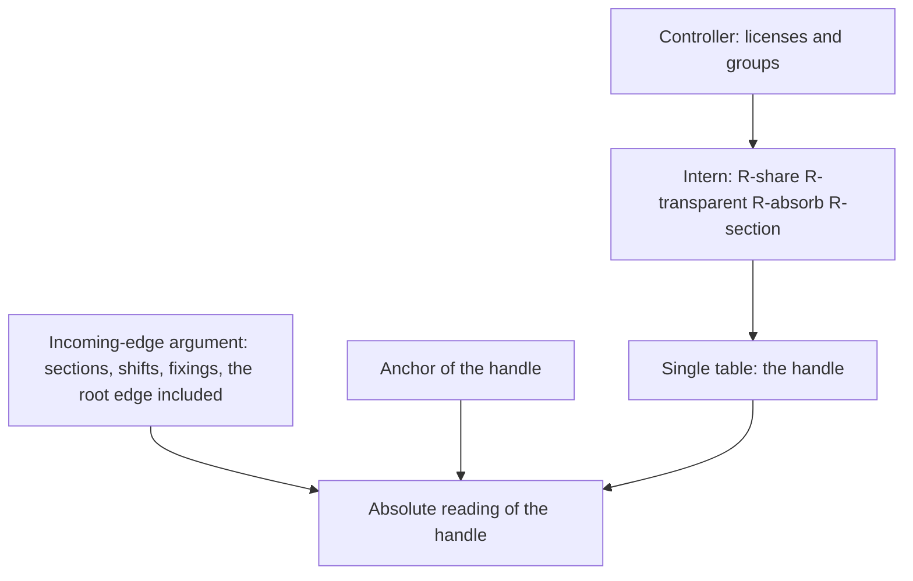

## 1. R-share: the sharing of equal forms

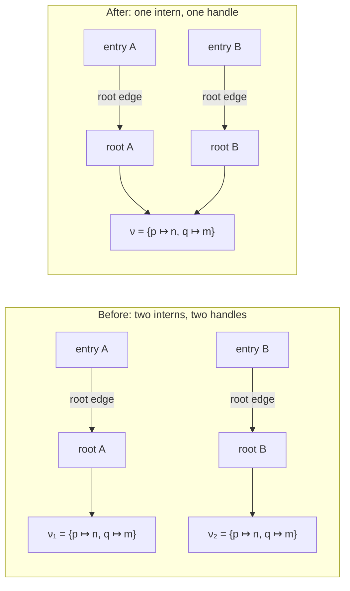

Two syntactically equal writings, one stored node. This is the single table of hash-consing: no controller license, no restoration, the most universal rule of the field. In the minimal core, this is the trivial case of R-section: the trivial group, every form is its own orbit.

Families: all, without exception. CUDD, Sylvan, MEDDLY, OxiDD, libddd, lisage: this is the common denominator of all implementations, since Bryant (1986).

## 2. R-transparent: the form crossed without stopping

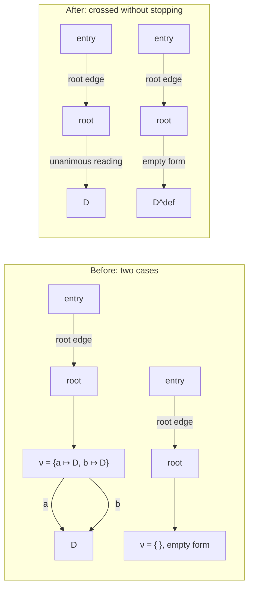

The empty form, or the one whose every edge, the implicit one included, leads to the same diagram D, reduces to D: the node does not exist, the traversal crosses it without stopping.

It absorbs R-collapse: the redundant ROBDD node (Bryant, 1986, the node with two equal children) is exactly the unanimous form. The guard does not change nature: the explicit edges and the implicit edge must cover Val(ℓ) and lead to the same D; on Val(ℓ) = {a, b, c}, the node {a ↦ N, b ↦ N} is not unanimous, the value c means something else, it survives. R-collapse had no content of its own: it was the unanimous form of the camp that assumes full coverage; R-transparent states it without a special case.

Families: ROBDD (Bryant, 1986, read here as unanimity), MTBDD and ADD (identical elimination), the fully-reduced MDD of the Ciardo school, the ZDD for the empty form; maintained in lisage by reduce_dabs (the D-trans clause of the code), tested at M4-3. Notable: the ZDD keeps its single-child nodes, precisely because they are not unanimous in the coverage sense; no rule is missing for them, the guard does the work.

## 3. R-absorb: absorption by the target

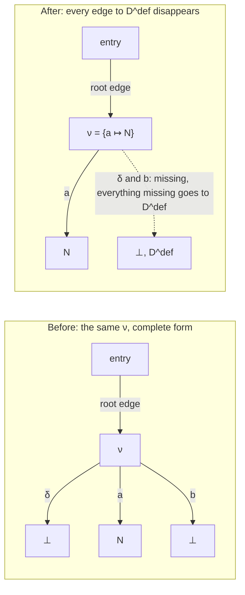

Every subdomain whose target is the default diagram D^def disappears, whatever its label. The restoration is by target: the reader knows that the missing goes to D^def, not which value led there.

It absorbs R-default: the designated value δ designates the default diagram, D_δ = D^def; the δ edge that leads to D_δ is an edge to D^def like any other, it disappears by the same absorption. R-default was not an independent rule: it is the value-side encoding of the same absorption, with a restoration by value (the reader knows that only the slot δ can be missing) instead of a restoration by target. The value/target divide remains the BDD/ZDD line of the field, and the polyDD don't care ("do not store a variable the value of which is meaningless") still lives there, as an encoding variant.

The convention D_δ = D^def, verified. The code owns a single designation: the is_default predicate of the intern is built on default_payload ([arena.rs](../crates/lisage-core/src/arena.rs)), the same filter tests D_δ in the reduction chain and D^def in reduce_dabs; the reference schema writes D_δ = terminal(false) on presences, and every controller instantiates the same terminal. The instance table of the specification (§2.4.1 of [the specification](specification-computing-attributed-transductions-reference-instance.md)) makes the two coincide on every row: don't care, the jump continuation; ZDD, the empty-presence diagram; MTBDD, the neutral terminal. The limit case "the rest ↦ D₂ ≠ D^def" has no δ (value levels have no designated value), so it cannot diverge. Two deeper reasons forbid divergence anyway: two distinct defaults at a same level would make the restoration of a missing edge ambiguous (the value side says D_δ, the target side says D^def, only one convention can govern the reading), and the carrier continuation always ends at the terminal of the all-default path, never at an internal form, so D_δ is a terminal whatever happens. No counter-case found in the repository or in the bestiary; R-default loses its last proper role.

State of the code: R-default is today wired and active (default_active, the reduction that carries the Set and Map presence masks, δ = absent); R-absorb is maintained (reduce_dabs) and no controller activates it; the ZDD would be the instance. The re-reading is a specification gesture: D_δ = D^def verified, the value side survives as a restoration variant, the code migrates when the wiring follows.

Families: the ZDD of Minato (1993), the sparse canonical form of the Ciardo-school MDDs ("a node has as many children as the number of edges pointing to nodes encoding a non-empty set"), the Z-SDD (Choi, Xue & Darwiche, 2016).

## 4. R-section: one form per orbit, the element on the edge

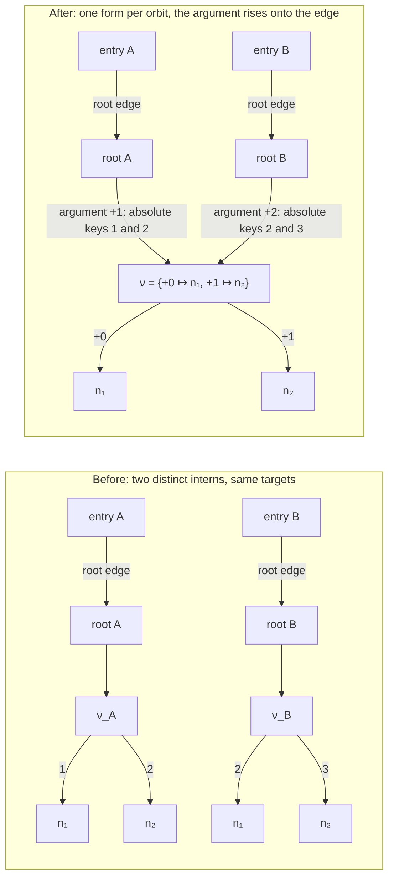

The controller designates a group G acting on the description of the form. The section is taken on the whole form, the edge set, never on an isolated edge: all keys of a form receive the same translation before sharing, a whole diagram has only one representative in the orbit {t, ¬t}. The stored form is the canonical representative of its orbit (section min = 0 for the order (ℤ,+)), the group element rises onto each incoming edge, and the composition is that of the group, O(1) per step. This is the generalization of R-share by the group action: R-share is to R-section what syntactic equality is to the orbit.

The same mechanism, on four channels. The specification already claims the unification (§2.4.5 of [the specification](specification-computing-attributed-transductions-reference-instance.md): the complement type is said there to be a group operation on the terminal convention). The code wires only the keys face, and as a declaration only: CycleGroup is never consulted by the pool.

| Face | Channel | Group | Argument on the edge | Families | Status |
|---|---|---|---|---|---|
| keys | keys | (ℤ, +) | +delta | none named; Wireshark | named here, not wired |
| complement | terminals, Boolean payloads | (Z₂, ⊕) | bit | CE-BDD, TBDD, CESRBDD, LIMDD, CUDD | specified (§2.4.5), not wired |
| swap | order of the children | S₂ | swap attribute | RexBDD | reread here |
| weighting | arithmetic payloads | (ℤ, +) | weight | EVBDD, FEVBDD, AADD | reread here, convention to verify |

### The keys face: the key shift

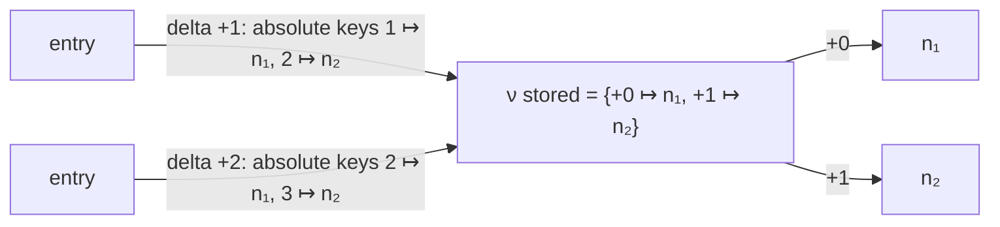

The descending face of the group: the form is stored rebased, the reading adds the argument on every key. Composition g(n₁) ∘ g(n₂) = g(n₁ + n₂), one O(1) step, never a resection on the way. Families: none in the bestiary, the cell is empty; real industrial precedent: Wireshark, relative TCP sequence numbers (section min = 0 applied to world traffic by default).

### The complement face: the function-level "not"

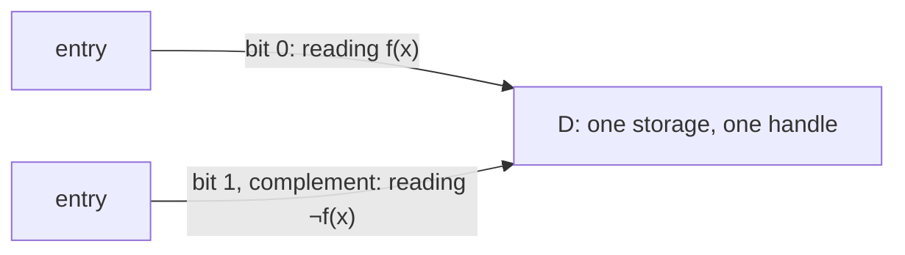

Ascending channel: the bit is consumed at the terminals. The terminal convention is the section: one stored per orbit {t, ¬t}. Families: CE-BDD (Bryant, 1989; Brace, Rudell & Somazzi, 1990), TBDD and CESRBDD (Babar, Ciardo & Miner), LIMDD (2022, edges typed by a group), and the root pointer of CUDD carries its complement bit: the root edge in person, the one that exists to carry the annotation when no parent remains.

### The swap face: the permutation of the children

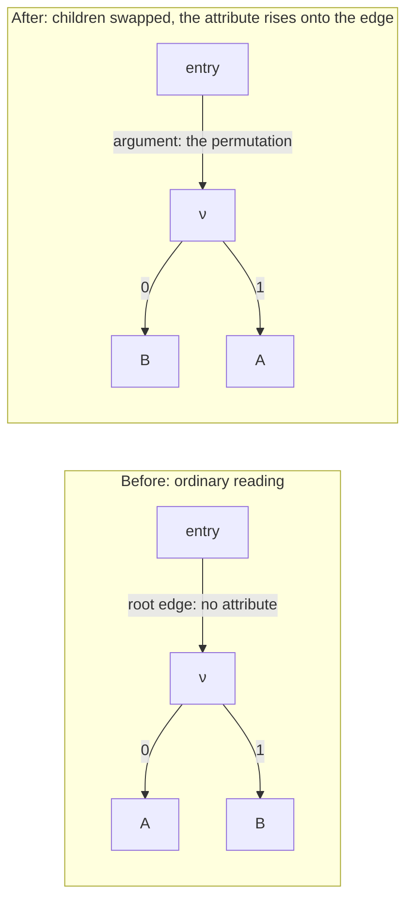

Same rank: the node does not change level, the canonical order of the children is the section, the permutation rises onto the incoming edge. Families: RexBDD (Ciardo, Miner, Deng & Babar, 2024), which gathers the three unary transformers (edge reduction, complement, swap), read here as as many groups on as many channels.

### The weighting face: the additive on payloads

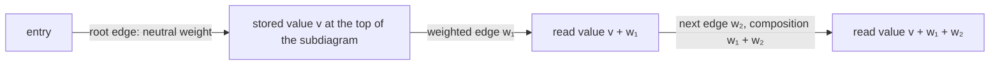

Algebra (ℤ,+) on the edge values, additive composition of the weights, neutral offset at the entry: the base of the section plays the same role as min = 0 for the keys. Families: EVBDD (Lai & Sastry, 1992), FEVBDD, AADD; related case: the affine edges of the BMDs (Bryant & Chen, 1995). Reserve: the exact neutralization conventions differ from one family to another (stated from memory, to be verified before enrolling the face in the contract).

## 5. The two channels outside the pool

The pool stays blind: these two channels carry their terms on the edges, never touching the stored form.

### Position shift: the +delta of variables

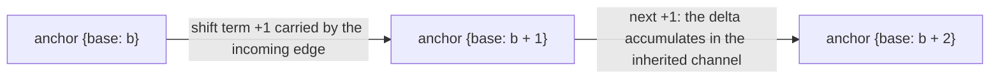

The stored forms do not move: only the offset of the anchor changes. Algebra (ℤ,+) on the anchor offsets, accumulation in the inherited channel. Families: ESDD (Devereux & Chechik, 2003, "relative variable on the edge (shift)", the precursor according to the [bestiary](state-of-the-art-decision-diagrams.md) of the repository); verified lisage instances: the philosophers (the shift on the edge, +1 per cell), the sliding window (the composed anchor {base, horizon}).

### R-fix, the fixing: position and key

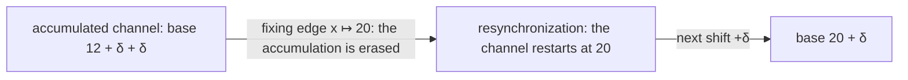

The overrides had a mechanism and no rule name; they have one: R-fix. Its faces carry the names of position fixing and key fixing, the rule is the same, the constant of the channel, the erasure of the accumulation.

Position fixing: the variable override, absolute writing x ↦ v, degenerate case of the same grammar ("the absolute writing the degenerate case", specification §2.4.5). Law: Fixing ∘ Shift(δ) = Fixing, the override erases the accumulation. The mechanism is the resynchronization point of the mixed encodings of the repository (relative inside, absolute at the seams, in the philosophers; the controlled-precedence mix of §2.4.2).

Key fixing, the proposal: the edge override, an incoming edge whose term is a constant v; the reading base of the child is fixed to v, independently of the deltas accumulated above. Admissible for the same reasons as its position sibling: the grammar admits it (the constant degenerate case, stated for variables, grammar common to the channels), the precedent exists (the §2.4.2 mix), the blind-pool doctrine organizes it without extension. Its algebra escapes clauses (i), (ii), (v), (vi) of §2.4.5, reserved for group elements: idempotent, Fixing ∘ Fixing = Fixing; absorbing on the right, Fixing(v) ∘ Shift(δ) = Fixing(v); not invertible, no kernel, no orbit section; regime effect: the neighborhood becomes heterogeneous again, the memos fall back on (form, argument), the sharing by section dies on the overridden paths.

Conditions to write into the contract for the keys face: a relative/absolute precedence designated by the controller; the interaction with R-section (an absolute edge to a sectioned child designates its absolute base, the resynchronization of the keys channel); the interaction with the absorptions (the δ clause of the coverage transported by the constant); the term in the controller fingerprint, same work site as the wiring of the faces.

### The generalization: the term as a function of the channel state

Fixing does not force the term to be a constant. The grammar already admitted it without saying so: a shift is the function acc ↦ acc + δ, a fixing is the constant function acc ↦ v, the only one that ignores its argument. The explicit generalization: the edge term is a function of the accumulated state, f: X → X on the space of the channel, from a family designated by the controller and closed under composition (clause (v) of the group contract, read for a monoid). The shifts become the invertible elements of the monoid, the fixing the extreme idempotent, and the intermediate tier is the non-constant retraction: idempotent, absorbing beyond its threshold, not below. The emblem: the window bound f(b) = min(b, horizon), everything past the horizon is read at the horizon, the paths that overflow merge their state.

Design reflex before enrolling a function: check that the need is not an element of a better-chosen group. The ring closure f(b) = (b + 1) mod n is a bijection, it belongs to the cyclic group (Z_n, +), it keeps the section and the sharing; the function-term is the exception of the seams, exactly like the constant.

What the intermediate tier pays, R-fix already pays: under a non-invertible term, no orbit, no section, the memos fall back on (form, argument); the renormalization does not cross (t_B ∘ t_A⁻¹ requires the inverse, the seam is a barrier, the conversions happen at the seam or do not happen); clause (vi) generalizes through the kernel of the function, two arguments leading there to the same state share, the others separate. What remains to be proven: canonicity under a non-invertible term, and the bestiary nowhere types its edges by a monoid (LIMDD types by a group): the cell is empty, to be verified before enrolling the tier in the contract.

### Confluence, the test of the thesis

The open point that commands everything: the confluence of the extended core, {R-share, R-transparent, R-absorb, R-section} with the channels {position shift, R-fix}, is not proven. The specification posits it for {D-abs, D-trans, R-share} (§2.4.1); every face of R-section and every face of R-fix require the same treatment, by proof or by pinned counterexample. "With only this, obtain everything" is demonstrated, or refuted, here. The total order (§6) transforms the question: once the chain is fixed, only the adjacent-guard validity remains to be proven, one adjacency at a time.

## 6. The total order: the chain from the channel to the pool

Definition. The application order of the five reductions is total:

R-fix ≺ R-section ≺ R-absorb ≺ R-transparent ≺ R-share

The symbol ≺ reads "executed before, at every handle creation where both apply". The chain reads from left to right as the execution pipeline; the reading of a diagram is its descending mirror.

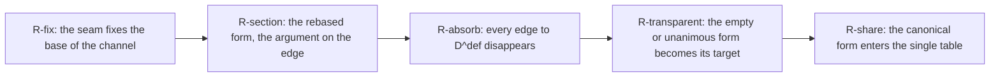

This order is not the order of generality. The absorption lattice (partial, not total) says which rules are cases of other rules: R-share under R-section as a trivial orbit, R-collapse under R-transparent, R-default under R-absorb. The chain says in which order to execute them. The lattice is a subsumption order, the chain is an execution order: the requirement of a total order can only be satisfied by the second.

The adjacencies, one by one:

R-fix ≺ R-section. The seam fixes the base of the channel before any descent: the section argument of a child is said relative to that base, never to what was accumulated above. The absorbing law Fixing ∘ Shift(δ) = Fixing makes the history of the channel indifferent downstream; what is below cannot undo the fixing, so the fixing must precede everything that refers to it.

R-section ≺ R-absorb. The section is the only rule that moves labels; it opens the chain of the pool so that every guard citing the keys (the coverage of R-transparent cites δ(ℓ)) reads canonical keys. Placing it elsewhere would force re-proving at every step that the δ designation survives the move; at the head, that obligation (the transported δ clause, already written into the conditions of R-fix) is localized once.

R-absorb ≺ R-transparent. Absorption can empty the form, and the empty form is the input of transparency: ν(ℓ, ∅) → D^def. The inverse order would leave unanimous forms that should have been empty. The code already practices this order: reduce_dabs filters the edges to D^def, then judges transparency.

R-transparent ≺ R-share. Sharing rewrites nothing, it notes identity; it can only compare canonical forms. A finding always comes last: the single table closes the chain, as the intern already closes the creation of the handle.

What the order buys. The chain is a function, not a relation: a form and a channel history give a single result, no implicit strategy subsists. The confluence of the arbitrary order is replaced by a finer and weaker object: the adjacent-guard validity, the proof that every guard remains checkable on the output of the previous rule. The confluence {D-abs, D-trans, R-share} of the specification is its first storey, and the inverse-order PBT of the repository (reduce against reduce_inverse) changes role: it stops being the definition of the order (two equivalent orders, tested against each other) to become the regression guard of a now-conventional chain.

Scope and limits. The chain executes at handle creation, children before parents: the total order governs every creation, the bottom-up sweep governs the ordering of the creations. The position shift does not appear in it: it is a channel, not a reduction; its compositions accumulate on the channel and the fixing erases them. R-fix belongs to the chain of the pool only through its place: it executes at the seam, on the edge, before everything that follows refers to the base it fixes.

## 7. The channel × algebra matrix

| | (ℤ, +) | (Z₂, ⊕) | constant, proposed retraction (idempotent, absorbing) |
|---|---|---|---|
| keys | R-section, keys face | atom rotation (exotic, unpopulated) | R-fix, keys face (proposal) |
| positions | position shift | none | R-fix, positions face |
| payloads / values | R-section, weighting face | R-section, complement face | the default-terminal designation: the object of the D_δ = D^def convention, not a rule |

Every group cell is the same rule, R-section, on its channel; the constant cells are R-fix. The terminal-designation cell is demoted: it is an encoding of the value side, the exact mirror of what R-default has become on the edges.

## 8. Traceability with the code identifiers

| Code identifier | Fate in the minimal core |
|---|---|
| R-share (reduce) | kept, trivial case of R-section (trivial group) |
| R-collapse (reduce) | absorbed by R-transparent (the unanimous form) |
| R-default (reduce, default_active) | reread: the value-side encoding of R-absorb, restoration by value |
| D-abs (reduce_dabs) | kept, R-absorb |
| D-trans (reduce_dabs) | kept, R-transparent |
| key shift (edge +delta) | keys face of R-section |
| edge complement | complement face of R-section, (Z₂,⊕) |
| child swap | swap face of R-section, S₂ |
| additive weighting | weighting face of R-section, (ℤ,+) on payloads |
| position fixing | R-fix, positions face, positions channel (specified §2.4.2 and §2.4.5) |
| key fixing | R-fix, keys face, keys channel (proposed) |

The code identifiers remain the reference: the full names, the absorptions, the unification of the faces and the single prefix are specification proposals, not renamings of the repository. R-collapse and R-default are today active in the code and carry the presence semantics; their rereading prepares the convergence of the contract, it removes nothing before the wiring follows. The unification of the prefix (everything in R-) is the same gesture: the repository keeps D-abs and D-trans as identifiers, the target specification has a single prefix.

## 9. Implementation pointers

The form rules live in [reduction.rs](../crates/lisage-algebra/src/reduction.rs) (reduce, the current reduction R-collapse and R-default; reduce_dabs, R-absorb and R-transparent, the D-trans clause of the code included) and are dispatched at the intern by [arena.rs](../crates/lisage-core/src/arena.rs) according to three controller predicates (collapse_active, generalized_absorption, default_active; no controller activates generalized_absorption, and the workshop FINGERPRINT does not yet cover the flags). A single designation of the default exists in the intern: the is_default predicate, built on default_payload, serves D_δ and D^def at once; the convention of §3 is thus already the one of the code. The chain of §6 generalizes the order of the code without breaking it: reduce chains unanimity then default, reduce_dabs absorption then transparency, the section (to be wired) would enter at the head of the chain of the pool, and the single table already closes every creation. The groups and the section min = 0 live in [relative.rs](../crates/lisage-algebra/src/relative.rs) (ShiftGroup, CycleGroup, InputArc), declared by no one, consulted by nothing; the anchor (AnchorRelative, CompositeAnchor) carries the position shift and the positions face of R-fix.

Status of this document: the minimal core, the absorptions and the unification of the faces are specification proposals; the short identifiers of the code (R-share, R-collapse, R-default, D-abs, D-trans) remain the traceability reference, to be kept alongside every full name.
