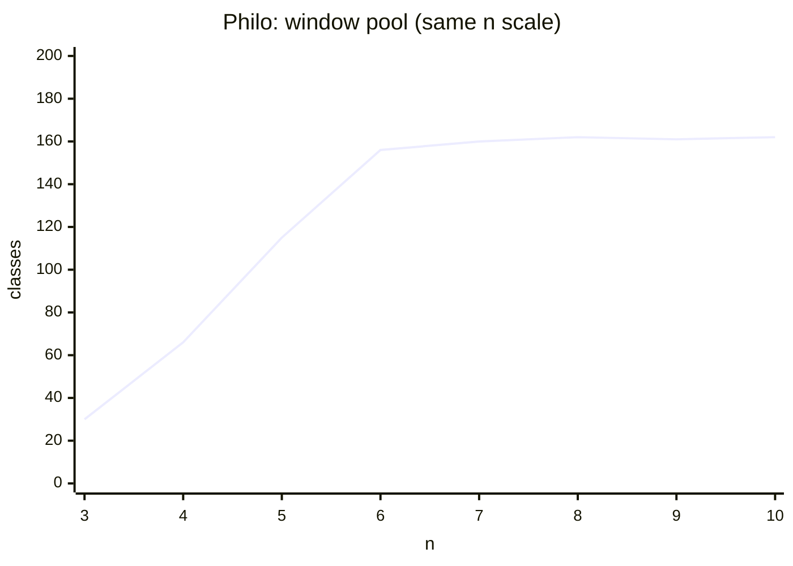

# Study on "homogeneity overload" over small instances

Small experimental study answering the three questions left open by the
discussion: (1) does the flat engine really grow in Θ(n) on the targeted
families; (2) does the windowed quotient bound the pool in O(1); (3) does
the controller-level classifier produce the correct seam plan before any
construction. As a side dish: S→S' against annotation, quantified.

All the families are **simplified proxies**, not the exact lisage model
([Projets saucisson](knowledge://knowledge/saucisson-projects/KNOWLEDGE.md)):
reduced local alphabets, no attributed transductions, no saturation. The
protocol: explicit BFS (ground truth), closed formulas as cross-checks, three
engines.

## 1. Model families

| Family | MCC proxy | A little grain of asymmetry |
|---|---|---|
| **Philo** (n = 3..10) | Philosopher: ring with 4 local states (T, L, E, R), left fork then right fork | none: homogeneous |
| **Presser** (n = 3..10) | Anderson/FMS-ish: philosopher 0 grabs its two forks **atomically** (2 local states) | class seam per module, fixed position |
| **Token** (n = 3..16) | TokenRing: ring {N, W, T, C}, one single token, critical section then left pass | seam per initial marking (unique holder) |

## 2. Three engines

- **flat**: exact positional MDD (single table including the exact position),
  over the raw ring. This is the "flat-hierarchical engine" of the debate.
- **anchored**: the same exact MDD, but over the set of configurations
  **anchored by rotation**. A witness: anchoring alone, without a window.
- **window**: cyclic windowed quotient; node class = (left cap, right cap,
  anchor letter, local triplet). A proxy of the lisage pool (sliding window
  + handles).

## 3. Results: Philo (homogeneous)

| n | reached \|S\| | consistent | flat | anchored | window pool | forms |
|---|---|---|---|---|---|---|
| 3 | 26 | 27 | 9 | 9 | 30 | 4 |
| 4 | 80 | 81 | 14 | 15 | 66 | 4 |
| 5 | 242 | 243 | 19 | 24 | 115 | 4 |
| 6 | 728 | 729 | 24 | 44 | 156 | 4 |
| 8 | 6 560 | 6 561 | 34 | 121 | 162 | 4 |
| 10 | 59 048 | 59 049 | 44 | 330 | 162 | 4 |

- **Closed formulas checked**: reached = 3ⁿ − 1, consistent = 3ⁿ, flat =
  **5n − 6** exactly.
- **The only consistent state ever reached**: (R, R, …, R), "everyone busy
  releasing to the right". Each should have passed through E (both forks),
  which no joint history allows. The quotient is therefore built over the
  reachable set, not over the local language.
- Window pool: **plateau 162** from n = 8 (161/162 oscillation = edge noise).

```mermaid
xychart-beta
  title "Philo: flat MDD (n = 3 to 10)"
  x-axis "n" [3, 4, 5, 6, 7, 8, 9, 10]
  y-axis "nodes" 0 --> 50
  line [9, 14, 19, 24, 29, 34, 39, 44]
```



## 4. Results: Presser (class seam)

| n | \|S\| | flat | pool S→S' | S' forms | annotated pool | annotated forms |
|---|---|---|---|---|---|---|
| 3 | 15 | 7 | 45 | 6 | 46 | 4 |
| 5 | 135 | 15 | 164 | 6 | 165 | 4 |
| 8 | 3 645 | 27 | 182 | 6 | 183 | 4 |
| 10 | 32 805 | 35 | 182 | 6 | 183 | 4 |

- Reached = **5·3ⁿ⁻²** exactly; flat = **4n − 5**.
- **S→S' against annotation, quantified**: nearly identical pools (182
  against 182 + 1 node decorated with the seam). The gain sits in the
  **forms table: 6 against 4 + 1**, i.e. 3×6 = 18 entries against 3×4 + 1 =
  13, **−28 %**. The overload buys quotient entries, not window nodes:
  consistent with the announced order of magnitude (~10 to 30 %), and no
  more.

## 5. Results: Token (marking seam)

| n | \|S\| = n·2ⁿ | flat = 2n−1 | anchored = n | window pool |
|---|---|---|---|---|
| 3 | 24 | 5 | 3 | 24 |
| 5 | 160 | 9 | 5 | 56 |
| 8 | 2 048 | 15 | 8 | 56 |
| 12 | 49 152 | 23 | 12 | 56 |
| 16 | 1 048 576 | 31 | 16 | 56 |

- All closed formulas checked (reached = consistent = n·2ⁿ; flat = 2n − 1;
  **anchored = n exactly**, one class per position).
- Window pool: **56, plateau from n = 5, never contradicted up to n = 16**.

## 6. Synthesis

| Quantity | Philo | Presser | Token |
|---|---|---|---|
| flat slope (nodes/n) | **5.00** | **4.00** | **2.00** |
| asymptotic window pool | **162** | **182 (+1)** | **56** |
| flat / pool crossing | n ≈ 34 | n ≈ 46 | n ≈ 29 |

1. **Θ(n) flat confirmed** on the three families, exact slopes 5/4/2 per
   module; at the scale of the MCC parameters (hundreds), that is a factor
   of 30 to 40 in nodes.
2. **The window is the load-bearing mechanism**, not the anchoring: the
   exact anchored MDD stays linear on the token (n exactly) and even
   **degrades** Philo (9 → 330 at n = 10, an artefact of the anchor choice
   by highest letter). Without handles/window, no fold holds in O(1); with
   them, the plateaus are clear.
3. **Controller detection validated**: the three plans were computed
   **before construction** (module classes + orbit of the initial marking)
   and were all correct: philo → empty plan (zero-injection checked: no
   overload needed, constant pool without decoration); presser → seam at
   module 0 (class singleton); token → dynamic anchor on the unique holder.
4. **Below the crossing point (n ≲ 30), the exact flat remains smaller than
   the window pool.** Honesty demands it: the lisage gain is asymptotic; it
   pays at MCC scale, not on toys with n ≤ 10.

## 7. Limits

- Proxy models: no attributes, no saturation, no events at a distance; the
  constants (162, 56) would be different in lisage, where the philosophers
  model with 7 forms is richer.
- The "window pool" counts node classes of the cyclic quotient, not the
  nodes of an unfoldable engine; it is a structure bound, not a measurement
  of `created`.
- Philo's "anchored" illustrates that a bad anchor choice costs; it is not
  a measurement of lisage.

## 8. Natural follow-ups

1. Inject these three families into `lisage-bench` (milestone M7) and
   measure real `created`, peak and pool against the 5n − 6 / 4n − 5 /
   2n − 1 obtained here: three straight lines expected.
2. Keep the **zero-injection** (empty plan on homogeneous Philo) as a
   non-regression test of the classifier.
3. The MCC PNML gives the NUPN units: the module classifier can be plugged
   directly onto the contest files.
